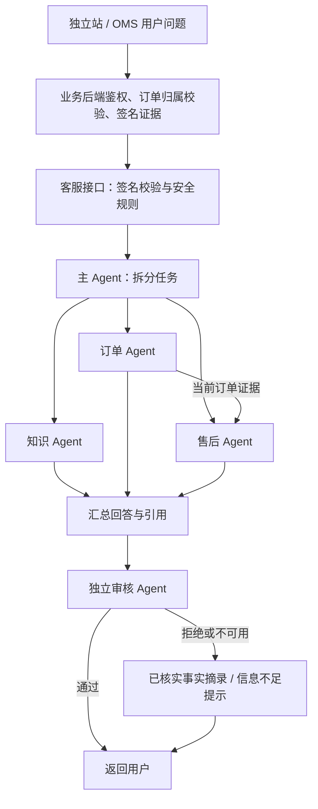

# OMS / 独立站 AI 客服子 Agent

本次为 OMS 与 BUZUD 独立站共用的独立客服服务加入真实的模型任务调度。沿用线上 `deepseek-flash`，没有切换自训练 LoRA，也没有新增常驻模型服务。

## 调用结构



| Agent | 职责 | 工具或限制 |
| --- | --- | --- |
| 主 Agent | 选择任务、拆分子问题、声明依赖 | 最多 3 个不同业务任务；服务端补齐必要角色并验证依赖 |
| 知识 Agent | 联系方式、门店、配送、一般 FAQ | `search_knowledge`，只能读取本次同来源 FAQ |
| 订单 Agent | 订单状态、金额及物流/退款证据是否齐全 | `read_order`，必须已登录，只能读取后端本次授权的订单 |
| 售后 Agent | 退换、维修、保修政策及条件 | `read_after_sales_policy`；同时涉及订单时，必须再调用 `read_order_result` |
| 审核 Agent | 检查证据支持、条件遗漏、无依据承诺 | 单独模型调用，只能通过或拒绝，不能改写事实 |

各 Agent 使用独立系统提示词和消息上下文，通过模型返回的 JSON 动作请求执行只读工具。每个业务 Agent 最多 2 次工具调用、3 次模型调用。订单与知识任务可并行，售后任务等待订单结果。工具返回当前请求的证据快照，不能让模型更换账号、指定另一个订单、访问任意 URL 或执行退款等写操作。

订单最终状态、金额和取消后的支付说明沿用确定性格式；中文售后政策保留原文条件。主流程汇总子任务结果与引用，再交给独立审核。问候、转人工指引、越权请求及不支持的业务操作仍可由明确规则直接处理。

## 边界与失败处理

- 身份来自已验签业务后端，不能由聊天文字指定。OMS 与独立站证据按来源隔离。
- 售后读取订单 Agent 已核实的证据，不把其他 Agent 的自由文本当成业务事实。
- 本次对话是否执行操作与历史业务状态分别处理；没有退款回执就不能确认退款到账。
- 无关 FAQ 不充当回退答案。模型失败、超时、伪造引用或审核拒绝时，返回可核实的摘录或明确说明信息不足。
- 不把模型回复或业务事实缓存到跨轮提示中；后续提问使用新请求提供的证据。
- JSON 模型请求遵循 [DeepSeek JSON Output 文档](https://api-docs.deepseek.com/guides/json_mode/)，由服务端严格校验结构并执行工具。异常日志只记录角色、错误类别及 HTTP 状态。

## 配置和可观测性

| 配置 | 本次部署 |
| --- | --- |
| `AI_INTEGRATION_AGENTS_ENABLED` | `true`，仅独立 support-suite 服务；默认值为 `false` |
| `AI_AGENT_TOTAL_TIMEOUT_SECONDS` | 24 秒，整条协作链上限 |
| `AI_AGENT_CALL_TIMEOUT_SECONDS` | 6 秒，单次模型请求上限 |
| `AI_AGENT_MAX_CALLS` | 11 次，整条协作链预算 |
| 并行限制 | 每轮最多 2 个业务任务；进程内最多 4 个模型请求 |

常规单角色问答通常为 4 次模型调用：拆分、请求工具、生成发现、审核。三个业务角色共同参与时通常为 9 次。每次调用都有额外延迟与模型用量，并非每条消息都会启动全部角色。

接口 JSON 保持原来的 `answer / intent / citations / requires_human / requires_confirmation`，无需改变 Java DTO。内部签名接口提供 `X-Support-Agent-Run`、`X-Support-Agent-Roles`、`X-Support-Agent-Degraded` 响应头。用户站点的业务后端暂未透传这些诊断头。

Docker 日志中的 `support_agent_run` 记录任务角色、依赖、模型调用数、工具名称、证据编号、审核状态和耗时；不记录问题原文、答案、账号、密钥或订单内容。可用 run ID 关联验证。

## 实现文件

- `services/ai-service/src/ai_service/application/support_agents.py`：调度、工具权限、依赖、汇总、审核与回退。
- `services/ai-service/src/ai_service/infrastructure/agent_model.py`：隔离的 JSON 模型调用、并发和超时。
- `services/ai-service/src/ai_service/api/integrations.py`：签名接口接入及诊断日志。
- `services/ai-service/src/ai_service/application/support_orchestrator.py`：修正公开客服邮箱与客户身份邮箱的区分，保留第三方隐私拦截。
- `services/ai-service/tests/test_support_agents.py`：并行、依赖、鉴权隔离、引用伪造、审核失败、超时等测试。
- `scripts/test_live_support_agents.py`：在独立 AI 容器中运行带签名的合成订单用例，不创建或修改业务订单。

## 部署与回滚

仅更新 `support-suite-support-ai-1`。版本化源目录为 `/opt/support-suite/current/ai-src-agents-20261106`，旧 `ai-src` 保留。原 NOVA AI 服务与业务后端不在此次更新范围内。

回滚配置保存在 `/opt/support-suite/backups/20261106-subagents/compose.json`。在服务器恢复该文件为 `/opt/support-suite/current/compose.json` 后，运行：

```sh
docker compose -f /opt/support-suite/current/compose.json up -d --no-deps support-ai
```

## 最终验收（2026-11-06，17:33 北京时间）

- AI 服务完整测试：**222 项通过**；新增文件和本次接入文件 Ruff 检查通过。pytest 有一条既有的 Starlette/httpx 弃用提示。
- 公网浏览器：**21 项通过**，包括 OMS 登录与模块、鉴权和越权边界、独立站多轮问答、英语配送、维修材料与客服邮箱复合问题、人工指引、注入拒绝和 CMS 登录。页面显示的回答也作了断言。
- 已部署签名接口：**3 组真实模型调用通过**，使用明确标记的合成订单证据，未创建、退款或修改业务订单。
- 三组分别为：订单 + 退货条件 + 客服邮箱（9 次模型调用，约 6.95 秒）、英语配送（4 次，约 3.87 秒）、OMS 取消订单的付款与退款查询（4 次，约 3.72 秒）。这些是本轮观测值，不是延迟保证。
- 最终一轮记录到 **7 条完整 Agent 链路**，均由模型规划、审核通过，未走回退；包含公网真实 FAQ 与合成订单用例。完整复合链路 run ID：`0c60644a-605c-4d6e-bf21-f64947ffb72e`。
- AI 健康接口正常，模型仍为 `deepseek-flash`，观测内存约 **57 MiB / 256 MiB**。原 NOVA AI 与 commerce-api 的启动时间与更新前一致。
- 联调期间发现并修正了公开客服邮箱误判、模型在同一轮输出多个工具动作、子任务越过自身职责解释其他角色信息，以及审核缺少本次执行上下文的问题。外部模型仍可能不可用或给出被审核拒绝的结果，生产保留安全回退。

本地验收证据目录：`data/deployment-154-20261106/subagents/`，包含部署源码哈希、测试输出、公网验收结果、合成用例回答和不含业务原文的 Agent 执行记录。订单相关的多 Agent 用例采用合成证据；真实客户订单的端到端售后资格判断不在此次验收结论内。
